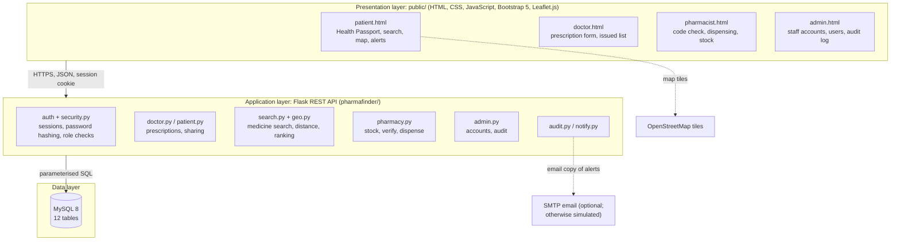
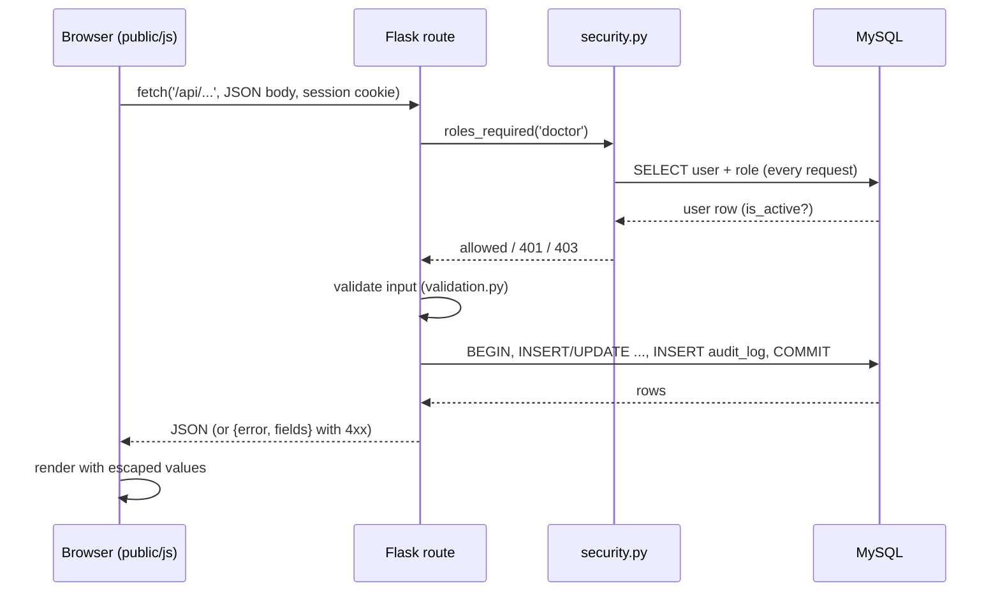
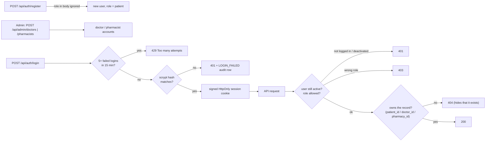
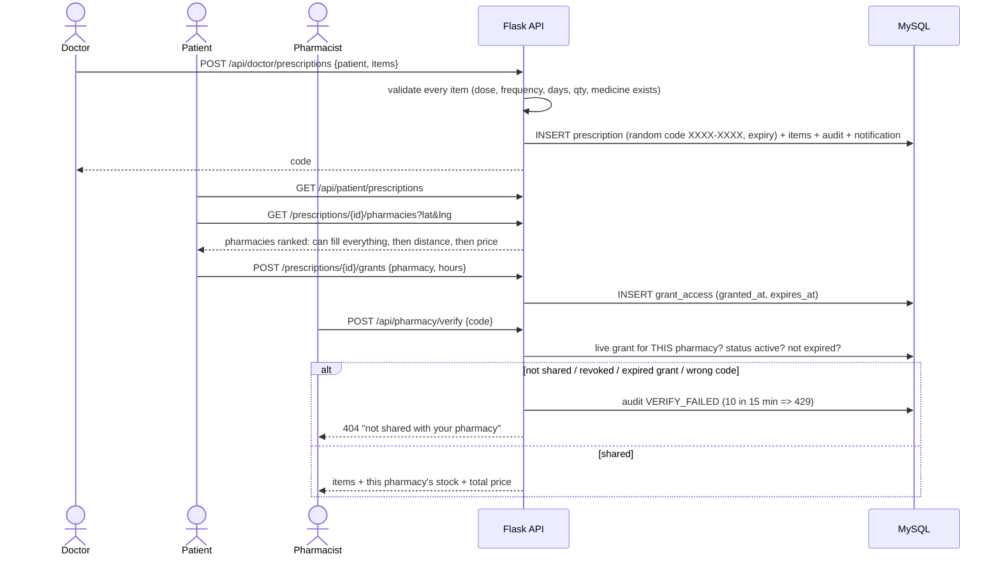
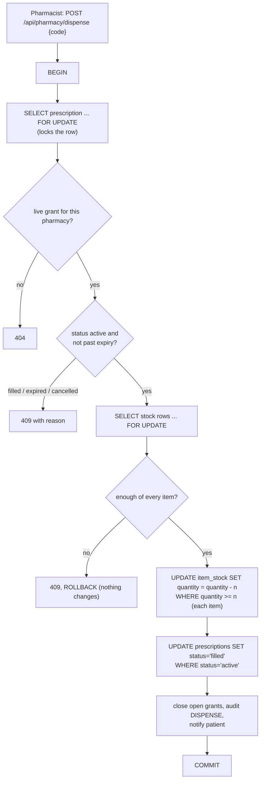
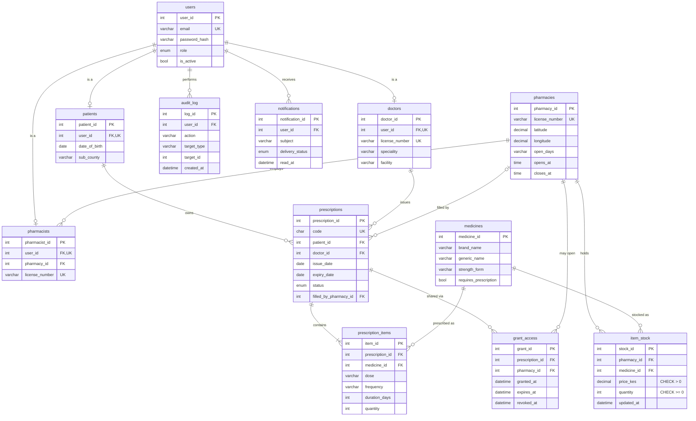

# PharmaFinder architecture

All diagrams are Mermaid. GitHub renders them directly; for slides, paste a block into
<https://mermaid.live> and export a PNG or SVG.

## 1. Three-tier architecture

The browser never talks to the database. Every permission check happens in the API, so hiding a
button in the page is never the only protection.

## 2. Request data flow

## 3. Authentication and role-based access

## 4. Prescription creation, sharing and verification

## 5. Stock and dispensing

Stock edits (`PATCH /api/pharmacy/stock/{id}`) lock the row, reject negative quantities and prices of 0 or less
(also enforced by `CHECK` constraints in MySQL), set `updated_at`, and write a `STOCK_UPDATE` audit row
recording the before and after values.

## 6. Entity relationship diagram

### How data is created, read, updated and deleted

| Data | Create | Read | Update | Delete |
|---|---|---|---|---|
| Users | Patients: sign-up. Doctors/pharmacists: admin | Own profile; admin list | Admin activates/deactivates | Not deleted, deactivated (keeps the audit trail intact) |
| Prescriptions + items | Doctor | Owner patient, issuing doctor, a pharmacy with a live grant | Status only: cancelled (doctor), filled (dispense), expired (automatic) | Never; history is kept |
| Access grants | Patient | Patient; pharmacy during the window | `revoked_at` set on revoke or after dispensing | Never; kept as history |
| Stock | Pharmacist (own pharmacy) | Everyone logged in, via search | Pharmacist edits; dispensing subtracts | Not exposed in the API |
| Medicines | Seed data; pharmacist adds missing ones | Everyone logged in | - | - |
| Audit log | Written by the API on every sensitive action | Admin | Never | Never |
| Notifications | Written when a prescription is issued or dispensed | Recipient | `read_at` | Cascades if the user row is removed |
